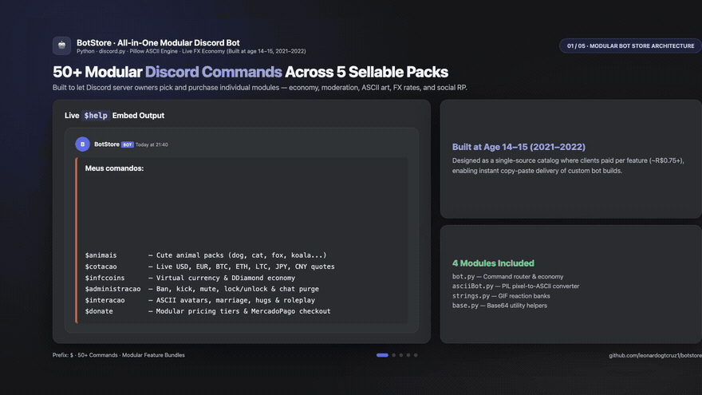

# BotStore — Modular All-in-One Discord Bot

Comprehensive modular **Discord bot** built with **Python**, **`discord.py`**, and **Pillow (PIL)** — originally created at ages 14–15 (2021–2022) as an interactive multi-category bot where server owners could browse, pick, and license individual feature packs (`$help`, `$cotacao`, `$animais`, `$administracao`, `$interacao`, `$infccoins`).


[](media/botstore-demo-en.mp4)

<p align="center">
  <a href="media/botstore-demo-en.mp4">▶ Watch full 1080p @ 30fps MP4 demo</a>
</p>

---

## Backstory

> Built at age 14–15 (2021–2022) with the goal of having every command of a full-featured Discord bot organized in one place so custom bot packages could be assembled and sold modularly to server owners. Kept untouched in its authentic Python structure as an early portfolio milestone, now documented cleanly for browsing.

---

## Key Features & Command Reference (Prefix: `$`)

### 1. Dollar-Backed Virtual Economy (`amounts.json` & `ddiamond.json`)
- Fetches live USD → BRL exchange rates via `economia.awesomeapi.com.br` so virtual **DDiamonds** dynamically reflect currency changes.
- Tracks user coin (`CCoins`) and diamond balances persisted locally in JSON.

| Command | Description |
| --- | --- |
| `$ccoins` / `$infccoins` | View CCoins wallet info and currency rules |
| `$ddiamonds` | Check your virtual DDiamond balance |
| `$prcddiamond` | Live calculated DDiamond price backed by USD/BRL rate |
| `$buyddiamond` / `$sellddiamond` | Buy or sell DDiamonds against your CCoins balance |
| `$transferir @user <amount>` | Transfer CCoins directly to another guild member |
| `$registrar` | Register a user wallet entry |

### 2. Live Fiat & Crypto Market Quotes (`$cotacao`)
| Command | Currency / Asset |
| --- | --- |
| `$dolar` | US Dollar (`USD → BRL`) |
| `$euro` | Euro (`EUR → BRL`) |
| `$iene` | Japanese Yen (`JPY → BRL`) |
| `$yuan` | Chinese Yuan (`CNY → BRL`) |
| `$bitcoin` | Bitcoin (`BTC → BRL`) |
| `$etherium` | Ethereum (`ETH → BRL`) |
| `$litecoin` | Litecoin (`LTC → BRL`) |

### 3. ASCII Avatar & Image Generator (`$ascii` via `asciiBot.py`)
- Converts any user profile avatar or local image into grayscale ASCII art using Pillow (`ASCII_CHARS = ["@", "#", "S", "%", "?", "*", "+", ";", ":", ",", "."]`).
- Usage: `$ascii @user`

### 4. Social, Marriage & Curated Animal Packs (`$interacao` & `$animais`)
- **Marriage System (`casais.json`):** Propose with `$casar @user` (requires ❤️ confirmation within 30 seconds or 💔 decline), inspect marital status (`$casado`, `$casada`), or split (`$divorcio`).
- **Roleplay GIF Reactions (`strings.py`):** `$hug @`, `$kiss @`, `$slap @`, `$punch @`, `$pat @`.
- **Cute Animal Libraries (`animais/`):** `$dog`, `$cat`, `$cow`, `$pig`, `$fox`, `$koala` served from categorized local image folders.

### 5. Moderation & Server Diagnostics (`$administracao`)
| Command | Action |
| --- | --- |
| `$ban @` / `$unban <id>` | Ban or unban a member (`$membrosbanidos` lists bans) |
| `$kick @` | Kick a member from the server |
| `$mute @` / `$unmute @` | Toggle member mute |
| `$lock` / `$unlock` | Lock or unlock text channel posting |
| `$clear <count>` | Bulk-delete channel messages |
| `$serverinfo` / `$userinfo @` | Inspect server stats or user profile/roles |
| `$comopegarid` | Quick Discord Developer ID helper |
| `$ping` / `$atts` / `$previsaoatts` | Latency check & bot release roadmap embeds |
| `$donate` / `$mercadopago` | Store pricing packages & checkout links |

---

## Project Structure

```text
├── bot.py             # Main Discord event loop, embeds, moderation & economy commands
├── asciiBot.py        # Pillow grayscale & ASCII character renderer
├── strings.py         # Curated Tenor GIF collections for social interaction commands
├── base.py            # Base64 encode/decode helpers
├── amounts.json       # CCoins balance persistence
├── casais.json        # Married pairs state persistence
├── ddiamond.json      # DDiamond balance persistence
├── animais/           # Categorized local image packs (dog, cat, fox, koala, pig, cow)
├── acoes/             # Local action GIF assets
└── requirements.txt   # requests, discord, PIL
```

---

## Getting Started

```bash
git clone https://github.com/leonardogtcruz1/botstore.git
cd botstore
pip install -r requirements.txt
```

1. Create a bot application in the [Discord Developer Portal](https://discord.com/developers/applications) and enable **Message Content**, **Server Members**, and **Presence** intents.
2. Add your bot token in `bot.py` (`client.run(TOKEN)` — or load it safely from an environment variable such as `os.environ["DISCORD_TOKEN"]` before running):

```bash
python3 bot.py
```

---

## Author

**Leonardo Cruz** — [GitHub](https://github.com/leonardogtcruz1)
